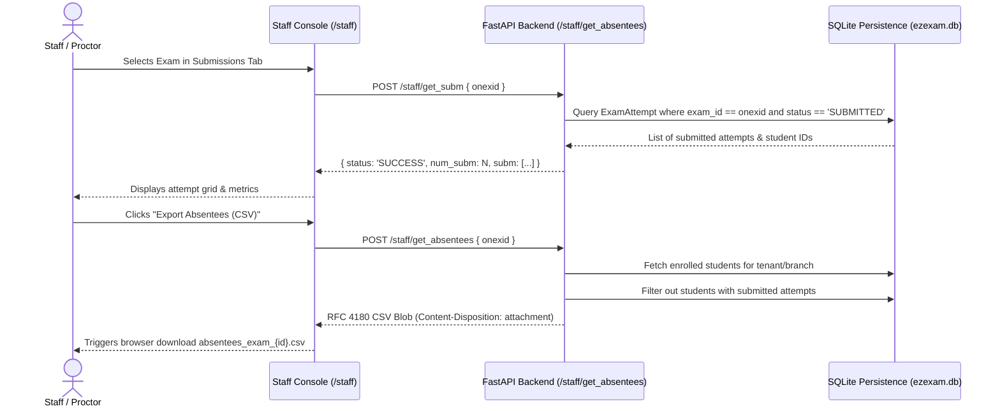

# FEAT-004: Candidate Absentee Tracking & Exam Submissions Lifecycle

> **Feature ID:** `FEAT-004` (Ref: `FEAT-05A` in Catalog)  
> **Status:** `SPECIFIED & IMPLEMENTED`  
> **User Roles:** Staff, Administrator, Faculty  
> **Primary Endpoints:** `POST /staff/get_absentees`, `POST /staff/get_subm`  
> **UI Entry Point:** Staff Dashboard $\rightarrow$ "Submissions & Analytics" tab $\rightarrow$ "Export Absentees (CSV)" action

---

## 1. Problem Statement & User Outcome

### Problem
Exam administrators need to quickly identify which candidates enrolled or assigned to an online examination have failed to take or submit their test before the session closes. Without an automated absentee reconciliation feature, proctors must manually compare candidate rosters against attempt logs.

### Outcome
Staff can click "Export Absentees (CSV)" on any scheduled exam. The system calculates the set difference between enrolled candidates and submitted attempts for that exam, streaming a structured RFC 4180 CSV containing absentee names, roll numbers, emails, phones, and batch cohorts for immediate campus outreach.

---

## 2. Evidence from Reference Artifacts

1. **Manifest Reference:**
   - `/staff/get_absentees` (Entry 46 in `captures/staff_endpoints_manifest.json`)
   - `/staff/get_subm` (Entry 65 in `captures/staff_endpoints_manifest.json`)
2. **DOM & Inline Handlers (`captures/staff_page.html`):**
   - Lines 17221–17228: *"Absentees are Students who were assigned the exam, but who have not yet attempted the exam. This is useful in case the Admin wants to notify Students to take the exam, before the Exam time closes."*
   - Lines 21186–21247: AJAX caller `getAbsentees()` passes `onexid` and `exam_rolls`, sets `responseType: 'blob'`, parses `Content-Disposition` attachment header, and triggers browser file download.
   - Lines 26190–26215: `getSubm(onex)` posts to `/staff/get_subm` with `onexid`, receiving `num_subm` and `subm` array.

---

## 3. Workflow & State Transitions



---

## 4. API Contracts

### 4.1 Submissions List
- **Method / Path:** `POST /staff/get_subm`
- **Headers:** `Authorization: Bearer <token>`, `Content-Type: application/json` or `form-data`
- **Request Body:**
  ```json
  {
    "onexid": 1
  }
  ```
- **Response Contract (HTTP 200):**
  ```json
  {
    "status": "SUCCESS",
    "num_subm": 2,
    "subm": [
      {
        "id": 101,
        "rollnum": "ROLL-001",
        "stud__rollnum": "ROLL-001",
        "name": "Student A",
        "score": 4.0,
        "total_marks": 20.0,
        "switch_count": 0,
        "time": "2026-10-21 21:05:00"
      }
    ]
  }
  ```

### 4.2 Absentee CSV Export
- **Method / Path:** `POST /staff/get_absentees`
- **Headers:** `Authorization: Bearer <token>`, `Content-Type: application/json` or `form-data`
- **Request Body:**
  ```json
  {
    "onexid": 1
  }
  ```
- **Response Contract (HTTP 200):**
  - **Headers:**
    - `Content-Type: text/csv; charset=utf-8`
    - `Content-Disposition: attachment; filename="absentees_exam_1.csv"`
  - **Payload Body:**
    ```csv
    Name,Roll Number,Email,Phone,Branch,Centre
    Charlie Candidate,ROLL-C-101,charlie@ezexam.test,9876543212,JEE-Main,Main Campus
    ```

---

## 5. Security & Isolation Rules

1. **Tenant Scoping:** Staff can only query submissions and absentees for exams created within their own `tenant_id`. Access to an exam from another tenant returns `HTTP 404 Not Found`.
2. **Student Privacy:** Absentee rosters are strictly restricted to authenticated staff accounts (`role in ['admin', 'faculty', 'chead']`). Unauthenticated or candidate requests are rejected with `HTTP 401 Unauthorized` or `HTTP 403 Forbidden`.
3. **Deterministic Calculation:** A candidate is defined as absent if and only if they are a registered student in the tenant matching the target cohort and have no `ExamAttempt` with `status == 'SUBMITTED'`.
